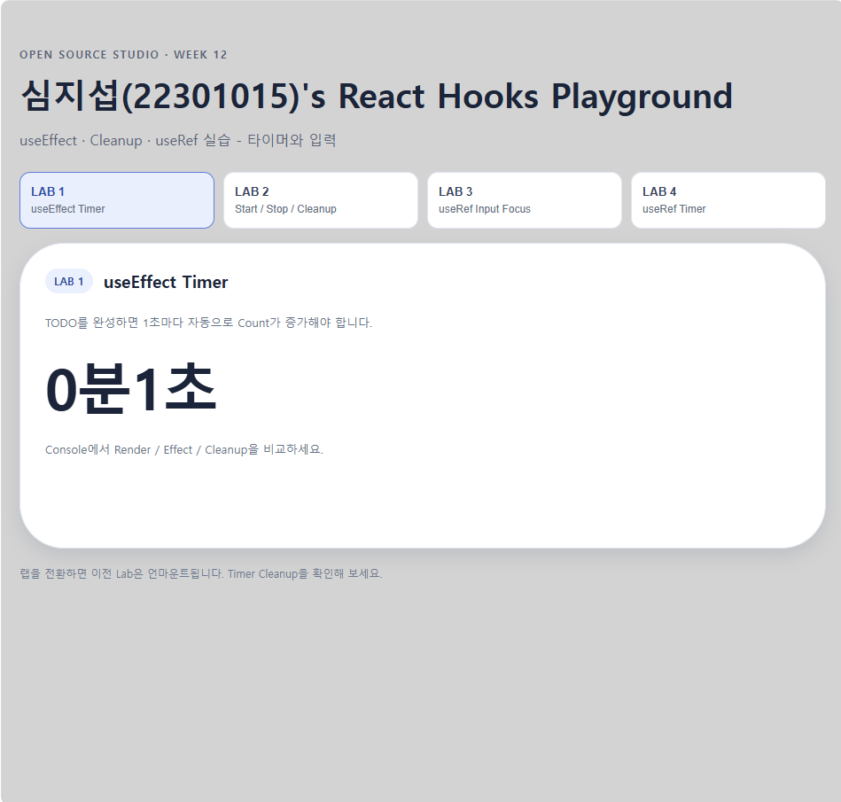
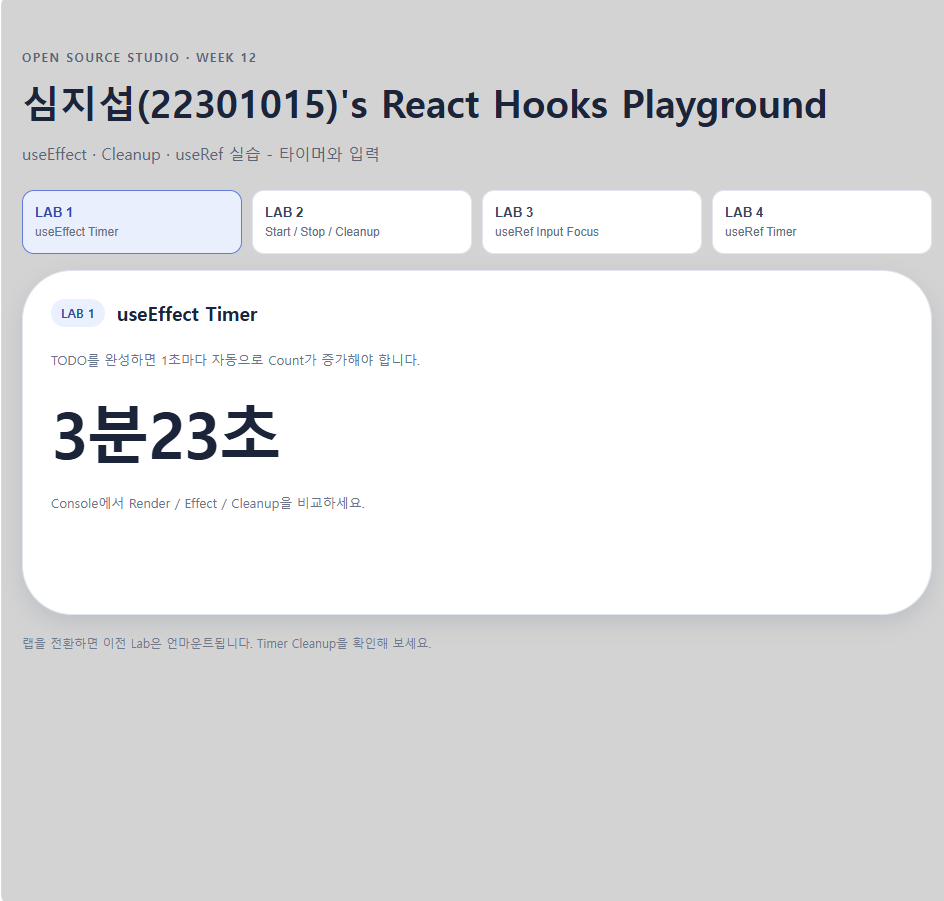
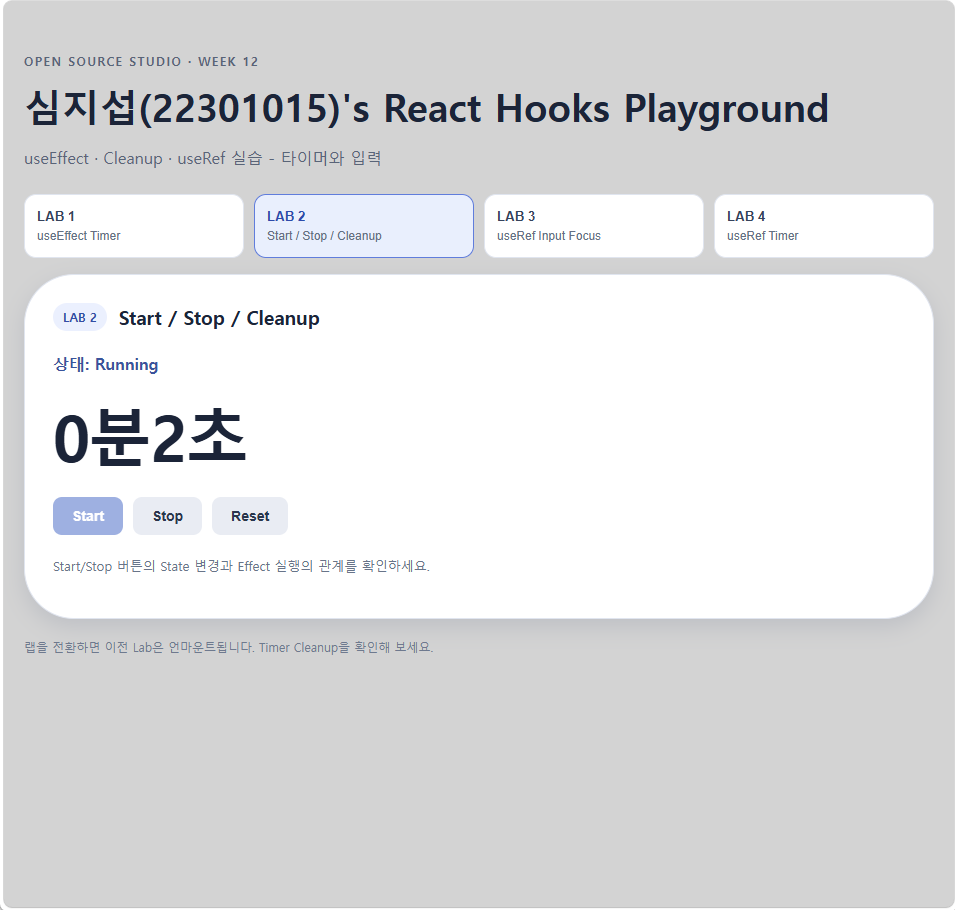
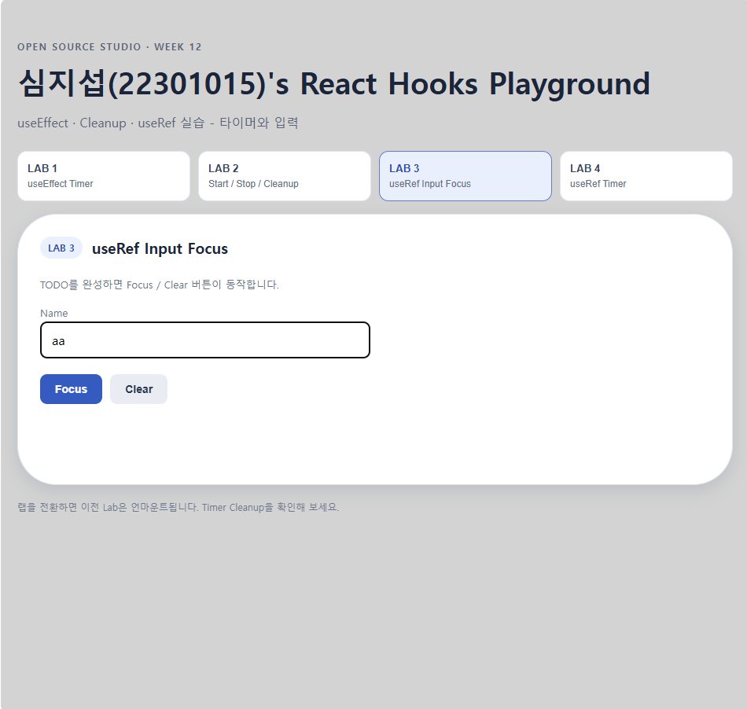
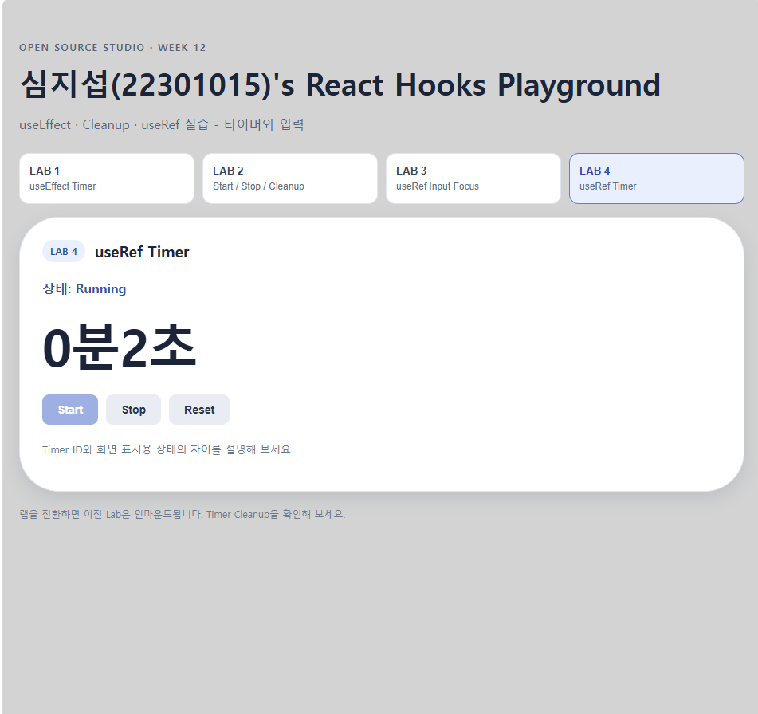

# OSS Week 12 — React Hooks Playground (Student Starter)

## 1. Project Information
- 프로젝트 : OSS React Hooks Playground
- 소개 : useEffect, Cleanup, useRef를 통해 4개의 Lab을 실습
- Starter Project : OSS Week 12 - React Hooks Playground에서 제공하는 4개의 Lab 파일 속 TODO를 작성

## 2. Installation
Node.js 20.19+ 또는 22.12+ 권장. 프로젝트 폴더에서 실행:

```bash
npm install
npm run dev
```

브라우저에 터미널의 Local URL을 열고 LAB 탭을 이동하세요. 제출 전 `npm run build`도 실행하세요.



## 3. Source Code Exploration
### 주요 파일 구조
- src
    - App.css
    - App.jsx
    - main.jsx
    - components
        - Lab1_EffectTimer.jsx
        - Lab2_TimerControl.jsx
        - Lab3_InputFocus.jsx
        - Lab4_RefTimer.jsx

### useEffect 및 useRef 분석
- useEffect
    - Lab 1 : 마운트 후 setInterval로 1초마다 setCount를 통해 count 1씩 증가 / ClearInterval로 interval 정리
    - Lab 2 : running이 true일 때 interval 생성하고 false면 return으로 생성하지 않는다 / running이 바뀔 때와 언마운트 때 clearInterval 실행
    - Lab 4 : 마운트 때 Cleanup만 등록 / 언마운트 때 clearInterval 실행 

- useRef
    - Lab 3 : inputRef를 ref={inputRef}로 연결하여 inputRef.current.focus(), inputRef.current.value =""를 사용
    - Lab 4 : timerRef를 통해 start이면 setInterval 실행, stop이면 clearInterval 후 null

### 주요 코드 설명 
1. Lab 1
```jsx
useEffect(() => {
  const id = setInterval(() => {
    setCount(prev => prev + 1);
  }, 1000);

  return () => clearInterval(id);
}, []);
```
- []을 통해 마운트 때 Effect가 한 번만 실행되어 interval이 하나만 생성된다. 
- 리렌더링 되어도 Effect가 다시 실행되지 않아 interval이 중복으로 생성되지는 않는다.
- 1초씩 count를 증가시키며 컴포넌트가 언마운트될 때 clearInterval로 interval을 정리한다. 

2. Lab 2
```jsx
useEffect(() => {
  if (!running) return;
  const id = setInterval(() => {
    setCount(prev => prev + 1);
  }, 1000);
  return () => clearInterval(id);
}, [running]);
```
- [running]을 통해 running이 바뀔 때마다 Effect가 실행된다.
- running이 true면 setInterval로 1초마다 count가 1씩 증가된다.
- running이 false이면 타이머를 멈추고, 새 타이머는 만들지 않는다.

## 4. Lab Implementation
- Lab 1 : useEffect + setInterval로 1초마다 count 1씩 증가, Cleanup으로 정리

- Lab 2 : running으로 Start, Stop, Reset 제어, Effect로 타이머 생성 및 정리

- Lab 3 : useRef로 input에 접근하고 focus() 및 값 초기화 구현 

- Lab 4 : useRef에 Timer id 저장, 중복 시작 방지, 언마운트 Cleanup


## 5. Lab Comparison
1. useEffect의 Dependency Array가 필요한 이유는?
    - Effect를 언제 다시 실행할지 정하기 위해 필요하다. 
    - 배열 안의 값이 어떤 것인지에 따라 Effect의 실행 타이밍이 정해진다. 
2. Cleanup을 사용하지 않으면 어떤 문제가 발생할 수 있는가?
    - 이전 Effect에서 만든 interval이 치워지지 않으면서 문제가 발생할 수 있다.
    - count가 1초에 여러 번 증가할 수 있다. 
3. useState와 useRef의 가장 중요한 차이는?
    - 값이 바뀔 때 useState는 리렌더링이 발생하고 useRef는 리렌더링이 발생하지 않는다. 
4. LAB 2와 LAB 4의 Timer 관리 방식은 어떻게 다른가?
    - Lab 2는 running의 값이 바뀌면 Effect가 타이머를 관리하게 되고, Lab 4는 버튼 handler가 setInterval과 clearInterval을 호출한다. 

## 6. Customizing
### 수정 내용 및 파일명
- src/App.jsx : 프로젝트 제목/설명 변경
- src/App.css : body background 색을 lightgrey로 변경
- src/App.css : .lab-panel의 border-radius를 50px로 변경
- src/components/Lab1_EffectTimer.jsx : Timer Count를 분/초 형식으로 표시
- src/components/Lab3_InputFocus.jsx : input이 빈 값일 때 에러 메시지 표시

## 7. Deployment
- Vercel URL : https://week12-starter-project-eta.vercel.app/

## 8. Weekly Review
### 새롭게 배운 내용 3가지
1. useEffect의 Dependency Array를 어떻게 하는지에 따라 Effect가 실행되는 시점이 달라진다는 것을 알게 되었다.
2. useRef는 값이 바껴도 리렌더링이 되지 않는다는 것을 배웠다.
3. Cleanup을 작성하지 않으면 타이머가 중첩되거나 컴포넌트가 사라진 뒤에도 계속 남을 수 있어서, setInterval을 쓸 때는 clearInterval로 반드시 정리해야 한다는 것을 알게 되었다.

### 어려웠던 점과 해결 방법
- 대부분의 코드가 제공되어서 큰 어려움은 없었으나 코드를 보며 작성하다보니 처음에 useEffect와 useRef의 차이를 파악하는데 조금의 어려움이 있었습니다. 그러나 코드를 작성하고 결과를 확인하면서 두 개의 차이점이 무엇인지 파악할 수 있었습니다.  

### AI 활용 내용 및 느낀 점 
- Lab 4에서 코드 작성 후 Start 버튼이 동작하지 않아서 어떠한 문제가 있는지 AI에게 도움을 받았더니 중복 시작 방지 조건을 !==이 아닌 ==로 작성한 문제를 발견했습니다. 
- 느낀 점 : 사람이 코드를 작성하다 생기는 실수를 AI가 빠르게 찾아주는 점은 편리했다. 다만 이런 실수를 처음부터 줄이려면 조건문 같은 기본 부분을 직접 꼼꼼히 확인하는 습관이 더 중요하다고 느꼈다.